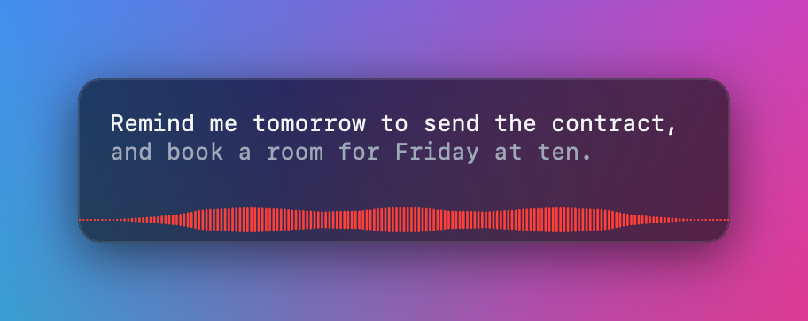
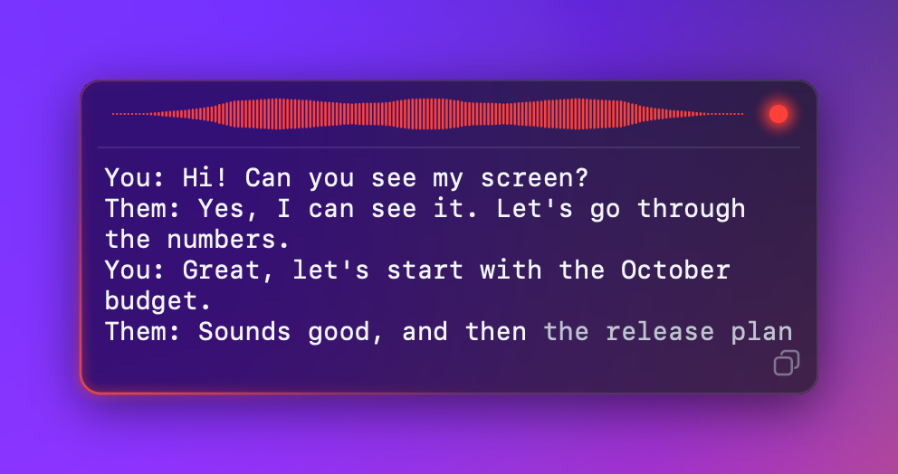
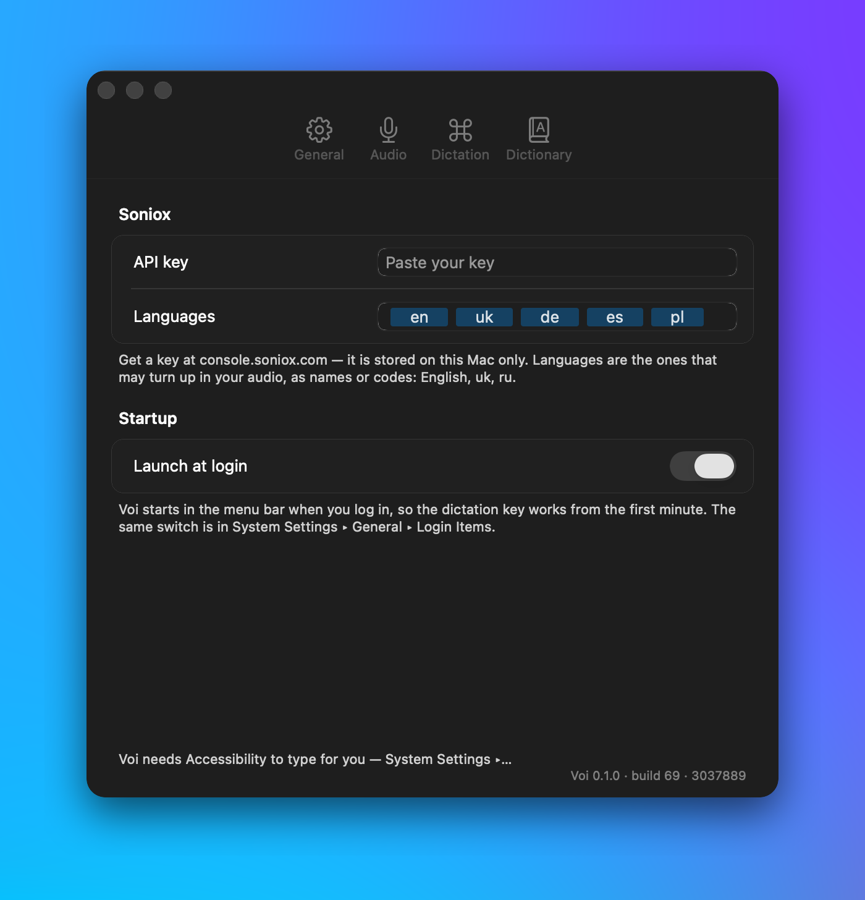
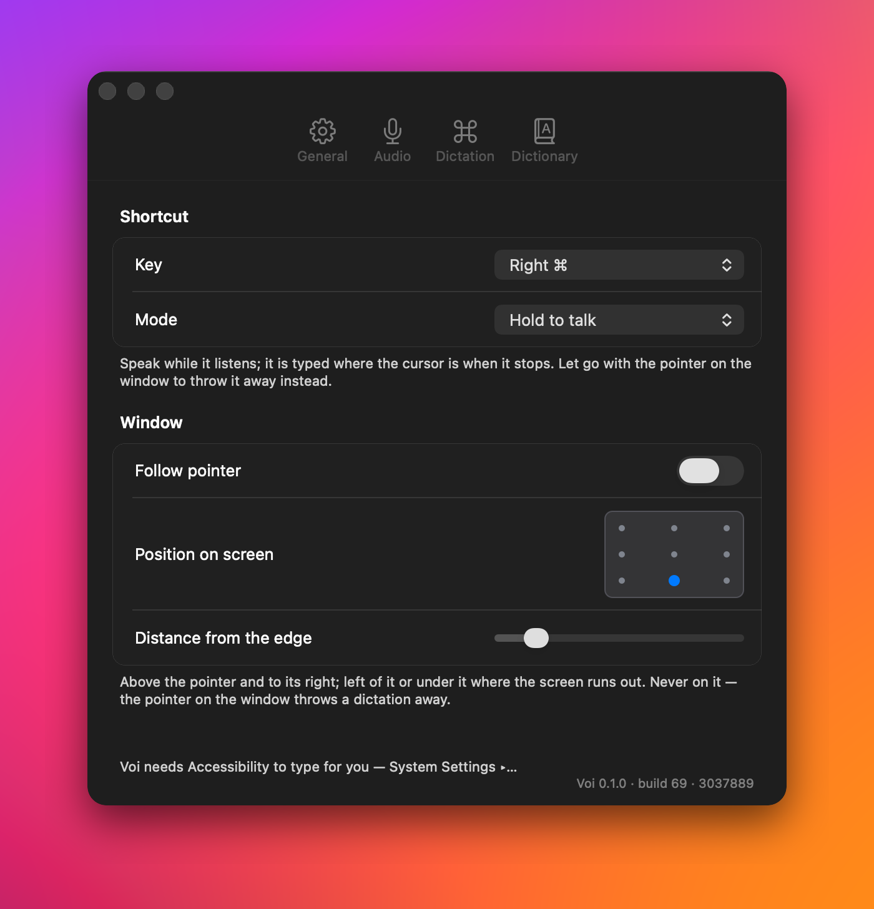

# Voi

Live transcription and dictation for macOS and Windows, in any language —
even switching languages mid-sentence.

**Bring your own key (BYOK).** Voi talks to [Soniox](https://soniox.com), the
speech recognition behind it, directly with your own API key. There is no Voi
account, no subscription and no server in between: your audio goes from your
computer straight to Soniox, and you pay Soniox only for what you use.

## Typing

Hold a key (Right ⌘ on the Mac, Right Ctrl on Windows), speak, and let go: the
text is typed wherever your cursor is. The words appear as you speak, beside
the pointer or wherever you put the window.



## Calls

A small HUD in the corner of the screen records both sides of a call, you and
them, and shows the transcript live. Each session is saved as a Markdown file.



## Settings

<p>
  
  
</p>

## Download

The latest build is always on the
[Releases](https://github.com/ontionos/voi/releases/latest) page:
`Voi-<version>.dmg` for the Mac, `Voi-<version>.exe` for Windows.

## Install

**macOS** (14.4 or later). Open the DMG and drag Voi into Applications. Voi is
not notarized by Apple, so the first time macOS may say it cannot verify it:
open System Settings → Privacy & Security and click **Open Anyway**. Allow the
microphone and, for calls, system audio when Voi asks.

**Windows** (10 or 11, x64). Run the `.exe`. It installs Voi for you alone,
with no administrator rights, and adds it to the Start menu. The installer is
not signed, so Windows may show "Windows protected your PC": click
**More info**, then **Run anyway**. Running a newer `.exe` updates Voi in
place; your settings, key and transcripts are kept.

## Your Soniox key

Sign up at [console.soniox.com/signup](https://console.soniox.com/signup/),
create an API key, and paste it into Voi's Settings → General. It is kept on
your computer only. Apart from Soniox, the one place Voi connects to is GitHub, to check
for updates.

## Updates

Voi checks for a new release now and then. When a newer build is out, **Update
Available** appears in its menu, just above Quit; choosing it downloads the
new file.

## License

Copyright (C) 2026 Voi contributors.

Voi is free software: you can redistribute it and/or modify it under the terms
of the GNU General Public License as published by the Free Software Foundation,
either version 3 of the License, or (at your option) any later version. It is
distributed in the hope that it will be useful, but WITHOUT ANY WARRANTY;
without even the implied warranty of MERCHANTABILITY or FITNESS FOR A
PARTICULAR PURPOSE. See [LICENSE](LICENSE) for the full text.

---

# For developers

## How it works

- **Records a call as two independent streams** — your microphone and the
  system's output — and transcribes both live.
- **Appears by itself** when another app takes the microphone, so a call does
  not start without it.
- **Transcribes existing recordings** too: a dictaphone file, a voice memo, up
  to five hours in one go.
- **Writes one readable Markdown file per session**, with timestamps.

## Why two streams

Soniox's real-time speaker diarization is documented as less accurate than its
async mode, and in testing it split a single continuous utterance across two
speaker IDs. So Voi does not rely on it to tell you apart from everyone else.

The microphone is you, by construction. System output is everyone else. No
inference, so no mistake is possible about which side said what. The one leak —
the other side coming back through your speakers into your microphone — is
recognised against the system stream and silenced before it is transcribed.

A **file** has no sides — it is one track — so there Voi does use diarization,
labelling what it finds `Speaker 1`, `Speaker 2`. Numbered, because diarization
separates voices without knowing whose they are.

## Requirements on macOS

- macOS 14.4+ (Core Audio process taps) on Apple Silicon
- A Soniox API key — paste it into **Settings…**
- Rust stable — **no Xcode required**, Command Line Tools are enough

## Install on macOS

```sh
./scripts/install.sh     # builds, draws the icon, signs, installs to /Applications
open -a Voi
```

To hand it to somebody else, `./scripts/dmg.sh` builds `target/Voi.dmg` — the
app and a shortcut to /Applications, so dragging one onto the other is the
whole installation. The key is not in it: it lives in Application Support,
never in the bundle, and whoever gets the image types their own into Settings.

Installing is not optional for capture to work. macOS grants audio permission
per *code-signed bundle*, keyed on `Info.plist` usage strings. A bare binary has
neither, so TCC cannot prompt and silently denies — which presents as a capture
that runs fine and records pure silence.

Because the bundle is ad-hoc signed, its identity changes on every rebuild, so
macOS asks for permission again after each `install.sh`. That is expected. It
also means Gatekeeper rejects the app on someone else's Mac; distributing it
properly needs a Developer ID and notarisation.

The API key lives in `~/Library/Application Support/voi/config.env`, never in
the bundle — so the app can be handed to someone else and they type their own.

## Using it

At rest the overlay is two things: three bars that move with the microphone, and
a red dot. Hover it for the live transcript and a copy button. Right-click its
header for the sessions folder. Drag it anywhere — it comes back where you left
it.

From the menu bar: start and stop, transcribe a file, settings, permissions.

Settings has four tabs — General (key, languages, launch at login), Audio,
Dictation and Dictionary. Audio is where to pick the microphone: the system's default unless
you choose another. With AirPods, choose the MacBook's own: opening the AirPods'
microphone switches them from music to headset mode and interrupts whatever is
playing.

Launch at login is kept by macOS, not by Voi: it is the same switch as System
Settings ▸ General ▸ Login Items, and works for the installed `/Applications/Voi.app`
only. From a shell: `/Applications/Voi.app/Contents/MacOS/Voi --launch-at-login on|off|status`.

## Windows

The same app as on the Mac, window for window: the HUD with the red dot in
the top-right corner and the live transcript when the pointer rests on it;
the dictation glass — hold the key, speak, let go, and it is typed where the
cursor is; Settings with the Mac's tabs, rows and texts; the Mac's menu, on
the notification-area icon. Every window is the same glass: the desktop
blurred behind it and the corners rounded by Windows itself,
the light running round its edge while it listens, the meter moving with your
voice; no title bars. What is the same and what is not, row by row, with
side-by-side pictures of both, is [docs/windows-parity.md](docs/windows-parity.md).

**The dictation key** is the Mac's choice with Windows' names for the same
keys: Right Ctrl where the Mac has Right ⌘ (the default), Left Ctrl for Left
⌘, Right and Left Alt for ⌥. Fn never reaches Windows, so it is not offered.
As on the Mac the key is watched, not taken: it still does what it did
everywhere else. Hold to talk, or click on and click off, in Settings ▸
Dictation, with where the glass appears.

**Finding the icon.** Windows 11 puts every new tray icon behind the **^**
next to the clock until you pin it; no program is allowed to pin itself. To
keep it on the taskbar, either drag it from the ^ panel onto the taskbar, or:

- Windows 11 22H2 and later: Settings ▸ Personalization ▸ Taskbar ▸ **Other
  system tray icons** ▸ switch **Voi** on.
- Windows 11 21H2 (build 22000): Settings ▸ Personalization ▸ Taskbar ▸
  **Taskbar corner overflow** ▸ switch **Voi** on.
- Windows 10: Settings ▸ Personalization ▸ Taskbar ▸ *Select which icons
  appear on the taskbar* ▸ **Voi**.

**Requirements:** Windows 10 or 11 (x64). To build: Rust stable with the
`x86_64-pc-windows-msvc` toolchain and the Visual Studio Build Tools' C++
workload (`winget install Rustlang.Rustup Microsoft.VisualStudio.2022.BuildTools`,
the latter with `--add Microsoft.VisualStudio.Workload.VCTools`).

**Install:** run `Voi-<version>.exe` (built below). It installs Voi for
you alone — no administrator, into `%LOCALAPPDATA%\Programs\Voi` — puts it in
the Start menu with its icon, starts it when you sign in if you leave that
ticked, and adds it to Settings ▸ Apps to remove. Running it again updates Voi
in place, stopping the running one first. Removing Voi keeps your settings,
key and transcripts. Or unzip `Voi-windows-x64.zip` anywhere and run `Voi.exe`;
it adds itself to the Start menu on first start. `cli\voi.exe` is the command
line — in its own folder, because `Voi.exe` and `voi.exe` are the same file to
NTFS.

Settings closes with the Mac's red circle in its top-right corner, **Esc** or
**Ctrl+W**, and reopens where you left it until Voi quits. Drag it by any
spot that is not a control.

**The key** goes into Settings ▸ General, or `cli\voi.exe key < key.txt`. It is
kept in `%APPDATA%\voi\config.env` with permissions for you and SYSTEM only,
never in the app's folder. Settings and transcripts sit beside it
(`settings.json`, `sessions\`); the log is `%LOCALAPPDATA%\Voi\Voi.log`.

**The record hotkey** is the one thing the Mac does not have: off unless you
set one, in Settings ▸ General ▸ Recording. Click the box and press the key or
combination you want; it then starts and stops a recording from anywhere, and
while it is set it is Voi's alone — the press and its release are swallowed
before any other program sees them, including programs that registered the
same shortcut first, and every other key goes through as usual. Windows' own
combinations (Ctrl+Alt+Del, Win+L, Alt+Tab, Alt+F4, Win+key and the like) and
bare typing keys are refused; ↺ or a double-click on the box turns it off.

**Launch at login** is the per-user startup entry Task Manager ▸ Startup apps
shows, asked of Windows each time rather than remembered by Voi; from a shell,
`Voi.exe --launch-at-login on|off|status`.

What is not the same as on the Mac:

- *Appearing when another app takes the microphone* reads the registry record
  Windows keeps for its own microphone-in-use indicator, rather than asking
  the audio system per process. A desktop program counts only while it is
  running: one that ended without letting go of the microphone stays marked
  there for good. Same effect; it cannot see a program that bypasses
  Windows' privacy tracking.
- The fonts are Windows' own: Cascadia Mono for SF Mono, set so a line holds
  the same characters, and Segoe UI Variable for SF Pro.
- The glass is blurred by Windows rather than Core Animation; it stays under
  the topmost windows of exclusive full-screen games, where Windows draws
  nothing else either.
- The keys cannot be heard inside windows of programs running as
  administrator (Windows does not let an ordinary program read keys aimed at
  an elevated one), and a program that installs its own low-level keyboard
  hook *after* Voi sees keys first. Most shortcut tools use `RegisterHotKey`,
  which Voi does beat.

## Giving the app to someone

The key never goes in the app; this is checked rather than trusted.

1. Build the package from a clean checkout:
   - Windows: `powershell -ExecutionPolicy Bypass -File scripts\package-windows.ps1`
     → `target\Voi-<version>.<build>.exe` and `target\Voi-windows-x64.zip`. The
     setup needs Inno Setup 6 (`ISCC.exe`, found where it installs or named by
     `ISCC`); without it only the zip is made.
   - **Signing (Windows).** Unsigned, Windows warns once ("Windows protected
     your PC") on a computer the setup was downloaded to. With a certificate,
     `package-windows.ps1` signs `Voi.exe`, the command line, the setup and its
     uninstaller: set `VOI_SIGN_THUMBPRINT` (a certificate in the store) or
     `VOI_SIGN_PFX` and `VOI_SIGN_PASSWORD`. No certificate is set up: the
     build is unsigned.
   - macOS: `./scripts/dmg.sh` → `target/Voi.dmg`
2. Both scripts end with the scan: `voi-scan` reads every file in the package
   and every string in every binary, and fails — deleting the package — on the
   key this machine uses (read from `SONIOX_API_KEY` or your own config at that
   moment, never stored anywhere), on anything shaped like a Soniox key, on a
   `SONIOX_API_KEY=` line, or on a config, settings or transcript file. Run it
   by hand on anything else you mean to send: `cargo run -p voi-scan -- <file, folder or zip>`.
   `cargo test` runs the same check on the binaries it builds, and
   `cargo run -p voi-scan -- --git` checks every commit in the repository.
3. Share only that zip or image. The person who gets it types their own key
   into Settings on first run.

## CLI

`install.sh` links the CLI onto your PATH as `voi`:

```sh
voi listen                       # record both streams until Ctrl-C
voi listen --mic-only            # skip system audio
voi listen --keep-audio          # also keep the WAVs
voi transcribe recording.m4a     # an existing file
voi sessions                     # list what has been recorded
voi show <session-id>            # print a transcript
voi repair                       # fix WAV headers after an interrupted run
voi key < key.txt                # store the Soniox key without echoing it

# Replay a WAV as if live — no permissions, no hardware.
voi listen --from-file fixture.wav --as-origin mic
```

## Output

One Markdown file per session in `~/Library/Application Support/voi/sessions/`
(`%APPDATA%\voi\sessions\` on Windows):

```
# 2026-08-04 00:18

[0:00:00] You: коротше, я думаю, дедлайн реалістичний
[0:00:06] Them: agreed, let's ship it
```

Audio is **not** kept by default. Two 16 kHz streams cost ~230 MB an hour, and
the transcript is what anyone actually reads. Pass `--keep-audio` if you want
the recordings too; `voi repair` fixes their headers if a run was interrupted.

## Layout

| Crate | Responsibility |
|---|---|
| `voi-audio` | Capture: microphone (cpal), system audio (Core Audio tap on macOS, WASAPI loopback on Windows), file replay, resampling, WAV, microphone-in-use watch |
| `voi-soniox` | Real-time WebSocket client and async file transcription |
| `voi-core` | Session model, segment building, on-disk layout, key storage, settings, the record hotkey's model |
| `voi-scan` | The check that no build or package carries a Soniox key |
| `voi-cli` | `voi` command-line binary |
| `voi-app` | The app: `src/mac` (menu bar and overlay, AppKit via objc2), `src/win` (tray, HUD and Settings, egui over Win32), and `engine.rs` / `state.rs` shared by both |

Everything outside `voi-app/src/mac`, `voi-app/src/win` and the two system-audio
backends is the same code on both systems.

## Testing

```sh
cargo test --workspace
cargo build --release --example probe && ./target/release/examples/probe
```

`probe` counts chunks and reports peak level per source — the fastest way to
tell a permissions problem from a capture problem. App logs go to
`~/Library/Logs/Voi.log`; a menu-bar app has no terminal.

On Windows, three more, which need the logged-on desktop rather than an SSH
session (a scheduled task in the user's session does it):

```powershell
cargo build --release -p voi-app --example hotkey_probe
target\release\examples\hotkey_probe.exe --voi target\release\voi-app.exe --data $env:TEMP\voi-probe --out probe.txt
target\release\voi-app.exe --screenshots shots    # HUD and Settings as PNGs
cargo run --release -p voi-audio --example loopback_check -- "<an output nobody listens to>" speech.wav
powershell -ExecutionPolicy Bypass -File scripts\windows-tray-check.ps1 -Start -RestartExplorer
```

**Run the tray check before every Windows release**, against the copy you
are about to ship (`-Voi <path to Voi.exe>`; the default is the installed
`%LOCALAPPDATA%\Voi\Voi.exe`). It works from SSH too: it starts Voi and
does its looking through one-shot scheduled tasks in the logged-on user's
session. It asserts that Explorer's own notification-area record holds an
icon owned by that Voi process; that the icon is on screen where a user would
look — on the taskbar, or in the ^ panel, which it opens — under a name
beginning with "Voi"; that right-clicking it opens Voi's menu with Settings
and Quit in it; and, with `-RestartExplorer`, that the icon comes back by
itself after explorer.exe is ended and restarts (open File Explorer windows
close when it does). It moves the pointer and opens the panel and the menu
for about a second, waits until nobody has touched the PC for 20 seconds
before doing so, puts the pointer back, and leaves a report and screenshots
in `%TEMP%\voi-tray-check`.

`hotkey_probe` plays every other program: its own keyboard hook and the same
combination claimed with `RegisterHotKey`, both in place before Voi starts.
It presses the hotkey and an unrelated key, and checks Voi got the one and
nobody got the other; repeats it with Voi gone, where the same checks must
fail; then picks a new hotkey in Settings, restarts Voi and checks the new one
is in force and the old one free. `loopback_check` plays a WAV into a silent
output — a virtual device, a monitor without speakers — and records it back
through Voi's loopback, so system capture is tested with nothing audible.

## Things that cost a day to learn

Kept here because each one presented as something else entirely.

- **"The tray icon is not there" was an icon nobody could pick out.** Voi's
  Windows icon was added from the first build, but Windows 11 files new icons
  behind the ^ chevron, and there it was a bare white dot among twenty logos.
  The check that "confirmed" it missing read the closed panel through UI
  Automation, whose toolbar proxy reports no buttons at all for the tray on
  Windows 11 21H2 — the accessibility layer it sits on (MSAA) lists every one,
  `Voi - Idle` included. Ask Explorer (its toolbars' own records) and look at
  the open panel before believing an icon is missing.

- **Binary names must not differ only by case.** macOS filesystems are
  case-insensitive, so `target/release/Voi` and `target/release/voi` are one
  file and cargo silently overwrites one with the other.
- **Rust 2021 captures disjoint fields.** `async move { stream.rx.recv() }`
  captured only the receiver and dropped the audio device guard, which looked
  exactly like a capture backend producing nothing.
- **Core Animation will not render a shadow for a masked layer**, so every
  attempt to clip a glow to the panel border produced a bare line and no glow.
- **A mask is all-or-nothing.** Stacking masked bands to fake a soft edge
  contributes one hard edge each, and reads as concentric rings.
- **A hidden mask is an empty mask**, not an absent one — the content under it
  disappears. Switch a fade off by recolouring its stops, never by hiding it.
- **An `NSScrollView` insists on owning the offset.** Driving one from a frame
  loop means the wheel hands the position to AppKit and the next frame hands it
  back; the transcript now sits in a plain clip view whose offset is one number.
- **Timers in the default run-loop mode stop while a menu is open** — which is
  exactly when you are looking at the menu.
- **`NSMenu` auto-enables its items** and ignores `setEnabled` unless that is
  turned off.
- **Soniox sends speaker ids as strings**, and emits `<end>` control tokens
  inline with real ones.
- **A process registered for raw keyboard input stops getting its own
  low-level keyboard hook** whenever one of its windows is in front. winit
  registers every window for raw input, so the Windows hotkey worked over any
  other app and went deaf the moment Voi's Settings was clicked. Voi drops
  the keyboard half of that registration at startup.
- **eframe reads back only root and deferred windows.** A screenshot request
  to an immediate viewport is accepted and never carried out; Settings is
  captured with `PrintWindow` instead.
- **WASAPI loopback goes quiet rather than silent** when nothing plays: no
  packets at all, where a Core Audio tap delivers zeros. Soniox times words by
  the audio it was sent, so the gap is filled with silence — otherwise the
  other side's lines would land early against your own.
- **Windows retries a refused localhost port** for about a second before
  reporting it, where macOS refuses at once; a timing test assumed the latter.

## Design

See [`docs/design.md`](docs/design.md).
